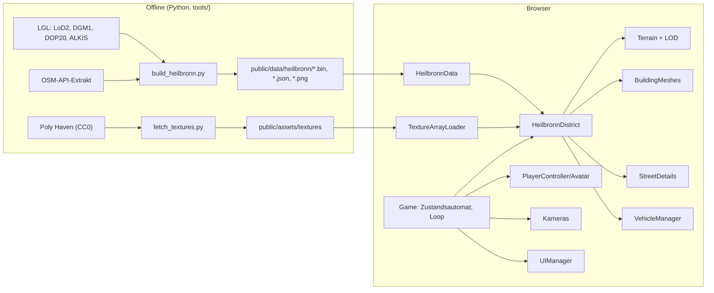

# Ist-Analyse: Architektur und technischer Stand

Stand: 26.11.2026, Commit `4e5ba8b` (Branch `claude/gta-heilbronn-foundation-4m1bhm`).
Dieses Dokument beschreibt den **aktuellen** Stand vor dem Umbau. Der Zielzustand und die
Migrationsstrategie stehen in [`UMSETZUNGSPLAN.md`](UMSETZUNGSPLAN.md).

---

## 1. Technologie

| Bereich | Technik | Bemerkung |
| --- | --- | --- |
| Sprache, Build | TypeScript 7 (strict), Vite 8 | Statischer Build, kein Server nötig |
| Rendering | Three.js r187, `WebGLRenderer` (WebGL 2) | eigene Shader per `onBeforeCompile` |
| Physik | Rapier 0.21 (WASM, `-compat` mit eingebettetem WASM) | Character Controller, Raycast-Fahrzeug, Heightfield, Trimesh |
| UI | reines DOM und CSS, ohne Framework | Startbildschirm, Pause, Einstellungen, HUD, Tacho |
| Geodaten-Pipeline | Python (numpy, shapely, pyproj, lxml, Pillow, scipy) | offline, Ergebnis liegt in `public/data` |
| **React / Next.js** | **nicht vorhanden** | Das Projekt enthält keine React- oder Next.js-Komponenten (siehe Abschnitt 10) |

Codeumfang (Zeilen):

| Modul | Zeilen | Dateien |
| --- | ---: | ---: |
| `src/world` (Gebäude, Gelände, Props) | 2 542 | 23 |
| `src/rendering` | 1 650 | 14 |
| `src/ui` | 702 | 9 |
| `src/core` | 579 | 5 |
| `src/vehicles` | 509 | 3 |
| `src/player` | 421 | 4 |
| `tools` (Python-Pipeline) | 1 136 | 6 |

## 2. Modulstruktur und Datenfluss

- `core/Game.ts` erzeugt alle Systeme (Composition Root). Die Physik läuft mit fester
  Schrittweite (60 Hz), das Rendering wird interpoliert.
- `world/District.ts` ist die Schnittstelle für Bezirke. Es gibt zwei Bezirke:
  `HeilbronnDistrict` (Standard) und `TestDistrict` (`?world=test`).
- **Es wird die gesamte Spielwelt auf einmal geladen.** Ein Nachladen während des Spiels
  (Streaming) gibt es nicht.

## 3. Geodaten-Pipeline (`tools/geo`)

| Schritt | Quelle | Ergebnis |
| --- | --- | --- |
| Gelände | LGL DGM1 (1-m-Raster) | `terrain.bin`, 551 × 701 Punkte im 2-m-Raster, Flussbett ausgehoben |
| Gebäude | LGL LoD2 (CityGML) | `buildings.bin`: Wände und Dächer trianguliert, 48 Chunks à 200 m |
| Gebäudeattribute | ALKIS-Gebäude, OSM `building:material` | 10 Fassadenstile, Material-Override |
| Dachfarben | LGL DOP20 (Luftbild 20 cm) | Medianfarbe je Dach |
| Flächen | ALKIS tatsächliche Nutzung, OSM Fußgängerzonen | `landuse.png`, 0,5-m-Klassenraster |
| Wasser | ALKIS-Gewässer | `water.bin` |
| Details | OSM (offizielle API, ein Abruf) | Markierungen, Überwege, Ampeln, Bäume, Bänke, Haltestellen, Uhr |

Koordinaten: Quelle **EPSG:25832** (UTM 32N). Spielkoordinaten sind UTM minus Ursprung
(Marktplatz E 515962 / N 5443270), mit `x` nach Osten, `y` nach oben und `z` = −Nord.

**Inkonsistenz:** `src/geo/GeoProjection.ts` rechnet lat/lon mit einer einfachen
Plattkarten-Näherung um. Gegenüber UTM weicht das um bis zu 0,17° Drehung und rund 3 m pro km
ab. Zur Laufzeit wird die Klasse derzeit nicht benutzt. Vor jeder Nutzung mit lat/lon-Daten
muss sie durch eine echte UTM-Transformation (proj4) ersetzt werden.

**Spielgebiet:** 1,1 × 1,4 km (Innenstadt zwischen Experimenta und Kilianskirche). Die
Pipeline ist auf dieses eine Rechteck festgelegt; es gibt keine Kachelstruktur für das
ganze Stadtgebiet.

## 4. Gebäude

- Grundlage sind **1 684 echte LoD2-Gebäude** mit amtlichen Grundrissen, Höhen und
  Dachformen. Das sind keine erfundenen Quader.
- LoD2 enthält aber nur **ebene Wand- und Dachflächen**. Alle Gebäude zusammen haben gerade
  einmal **46 682 Wand- und 17 684 Dachdreiecke**, also im Schnitt 38 Dreiecke pro Gebäude.
- Fenster, Ladenfronten, Gesimse und Sockel sind **nur in den Shader gemalt**
  (`FacadeMaterial.ts`). Sie haben keine Tiefe, keine Laibungen und keine Rahmen als
  Geometrie. Balkone, Türen, Markisen, Rollläden, Dachrinnen, Schornsteine und Gauben fehlen.
- Fensterraster werden je Wand gleichmäßig verteilt. Brandwände und Wände zum Nachbarhaus
  werden **nicht erkannt** und bekommen deshalb ebenfalls Fenster.
- **Stilzuordnung:** 831 Altbau, 395 „Klein“ (Garagen, Schuppen, Bauwerke unter 4 m,
  fensterlos), 158 Klinker, 120 Nachkriegsbau, 89 Gewerbe, 68 Modern, 13 Brücken,
  4 historisch, 3 Kirche/Turm, 3 Glas.
- **Ursache für die „Betonblöcke“:** Die 395 kleinen LoD2-Bauwerke werden als fensterlose
  Putzkörper dargestellt. Dazu kommen Schließflächen (`ClosureSurface`) von Gebäudeteilen,
  die mit derselben schlichten Fassade gerendert werden.
- Wahrzeichen (Kilianskirche, Rathaus, Götzenturm) haben nur ihre LoD2-Form. Turmspitzen,
  Arkaden und Maßwerk fehlen.

## 5. Straßen und Boden

- Das Gelände ist ein Höhenraster mit **drei Detailstufen** (2 m, 4 m, 8 m) und Randschürzen.
- Straßenbeläge werden im Shader aus dem 0,5-m-Flächenraster gemischt.
  **Bordsteine sind nur aufgemalt**; Gehwege sind nicht erhöht, und es gibt keine
  Straßengeometrie.
- Aus OSM kommen Fahrbahnmarkierungen (19 712 Dreiecke), Zebrastreifen, Ampelfurten und
  Stadtbahngleise als Decals.
- Es fehlen Gullys, Kanaldeckel, Radwege, Verkehrsinseln, Parkbuchten, Straßenschäden,
  Verschmutzung und Verkehrsschilder.

## 6. 3D-Modelle und Texturen

| Kategorie | Stand |
| --- | --- |
| Externe 3D-Modelle | **keine.** Alle Modelle sind prozedural aus Grundkörpern gebaut |
| Laternen, Bänke, Poller, Ampeln, Bäume | einfache Grundkörper, instanziert (`PropModels.ts`) |
| Bushaltestellen | nur Mast mit H-Schild, **kein Wartehäuschen** |
| Autos | prozedural (Extrusion des Seitenprofils, Klarlack), 7 Typen |
| Spielfigur | Platzhalter aus Kapseln. Der Lader für Mixamo-FBX und GLB ist eingebaut, aber es liegt noch kein Modell vor |
| Texturen | 16 CC0-Sätze von Poly Haven (2K-Farbe, 1K-Normale), 19 MB, als Texture-Arrays |

## 7. Beleuchtung, Schatten, Materialien

- Licht: eine Sonne (fest Nachmittag), ein Hemisphärenlicht und Umgebungslicht aus dem
  prozeduralen Himmel (inklusive Bodenreflexion). Die HDRI-Aufnahme ist optional (`?hdri`).
- Schatten: ein einzelnes Shadow Map mit 4096 px über ±70 m, das dem Spieler folgt und auf
  Texel gerastert ist. **Keine Kaskaden**, deshalb fehlen Schatten in der Ferne.
- Nachbearbeitung: GTAO (Stufe „Hoch“), Farbgrading, MSAA bzw. FXAA. Bloom ist bewusst
  deaktiviert.
- Fehlt: Tag-Nacht-Wechsel, Bildschirmraum-Reflexionen bzw. Reflexions-Proben,
  Light-Probes, TAA und Nebel mit Lichtstreuung.

## 8. Fahrzeuge und Physik

- Rapier-Raycast-Fahrzeug mit Federung, Hinterradantrieb, Handbremse, Abtrieb und
  automatischem Aufrichten.
- Etwa 70 Autos parken am Bordstein, abgeleitet aus dem Flächenraster.
- Kollision: Gelände als Heightfield, Gebäude als Trimesh pro Chunk, Requisiten als Zylinder.
- Fehlen: KI-Verkehr, Schäden, Ampelschaltung, Fußgänger.

## 9. Performance und Ladezeiten

| Kennzahl | Wert |
| --- | --- |
| JavaScript-Bundle | 5,2 MB (1,9 MB gzip), davon ~3 MB Rapier-WASM als Base64 |
| Spieldaten | 7,2 MB (Gebäude 5,4 MB, Markierungen 1,2 MB, Gelände 0,8 MB) |
| Texturen | 19 MB (2K) |
| **Gesamter Download beim Start** | **≈ 31 MB**, ohne Streaming und ohne Cache-Strategie |
| GPU-Speicher Texturen | ≈ 380 MB (Stufe Hoch, 2K) bzw. ≈ 95 MB (1K). Unkomprimiert RGBA8, **kein KTX2** |
| Dreiecke | Gelände-LOD0 770 000, Gebäude 64 000, gerendert typischerweise 0,4 bis 1,3 Mio. inklusive Schattenpass |
| Draw Calls | ≈ 110 bis 250 (zwei pro Gebäude-Chunk, ein InstancedMesh pro Requisitentyp, Fahrzeuge einzeln) |
| CPU pro Frame | Simulation 1 bis 9 ms, Render-Submit 2 bis 16 ms (gemessen in Headless-Chromium) |
| Monitoring | F3-Overlay mit FPS, Draw Calls, Dreiecken, CPU-Zeiten. **Fehlt:** Speicher, geladene Assets |

Die Messungen in der Cloud-Umgebung laufen mit Software-Rendering (SwiftShader). FPS-Werte
von dort sind nicht aussagekräftig; nur CPU-Zeiten und Zählwerte sind belastbar.

## 10. React und Next.js

Das Projekt nutzt weder React noch Next.js. Falls ein anderes Repository mit
React/Next.js gemeint war, muss es in die Sitzung eingebunden werden. Für den Spielkern
empfiehlt sich React ohnehin nicht (siehe Umsetzungsplan, Entscheidung E1).

## 11. Verifikation gegen reale Daten (26.11.2026)

Werkzeug: `tools/geo/verify.py`. Interaktive Ansicht: `docs/verification/index.html`.

| Prüfung | Ergebnis |
| --- | --- |
| LoD2-Grundrisse gegen OSM-Grundrisse (1 681 gegen 1 454 Gebäude) | Median-IoU **0,833**, 86,5 % mit IoU > 0,5, Median-Versatz der Mittelpunkte **0,68 m** |
| Überbaute Fläche gesamt | IoU 0,803. Abweichungen kommen vor allem von unterschiedlicher Aufteilung zusammenhängender Häuser |
| OSM-Gebäude ohne LoD2-Gegenstück | 30 Gebäude, 6 090 m² (Neubauten und Kleinbauten) |
| OSM-Straßenachsen auf ALKIS-Verkehrsflächen | Haupt-, Neben- und Kreisstraßen **100 %**, Wohnstraßen 93,6 %, Hofzufahrten 54,7 % (Kataster führt sie als Grundstück) |
| Wahrzeichen OSM gegen LoD2 | Kilianskirche 0,56 m, Theater 0,45 m, Experimenta 0,09 m, Götzenturm 0,73 m, Rathaus 2,92 m (andere Abgrenzung des Gebäudekomplexes) |
| OSM-Punkte in Gebäuden | Bushaltestellen 2/30, Bänke 7/134, Bäume 1/174, Ampeln 0/69 |
| Straßenlaternen in OSM | **0 erfasst.** Laternen müssen aus anderer Quelle oder regelbasiert gesetzt werden |

**Fazit:** Georeferenzierung und Straßennetz stimmen mit der Realität überein. Die Schwäche
liegt in der **Detailtiefe** (flache LoD2-Wände, gemalte Fenster, Grundkörper-Requisiten)
und im **fehlenden Streaming**, nicht in der Geometrie der Stadt.
