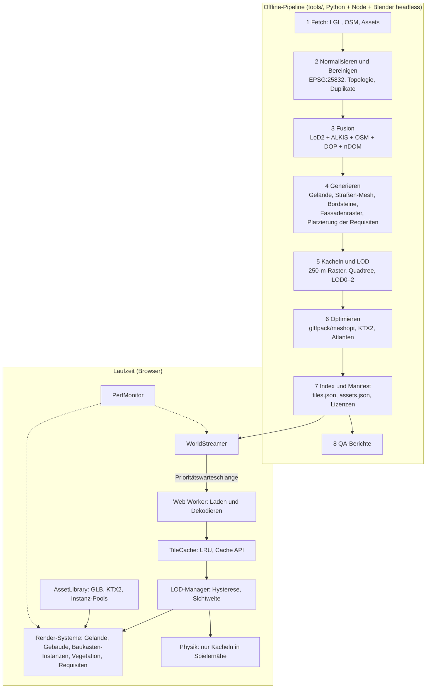

# Technischer Umsetzungsplan: realistische Heilbronn-Spielwelt

Grundlage ist die Ist-Analyse in [`ARCHITEKTUR_IST.md`](ARCHITEKTUR_IST.md).
Der Plan deckt sechs Aufträge ab:
- Geodaten-Grundlage mit Kacheln und Streaming
- Gebäudegenerierung
- Asset-Pipeline
- Straßen und öffentlicher Raum
- Performance
- visuelle Qualitätskontrolle

**Grundregel:** Bestehende Funktionen bleiben erhalten, bis ihr Nachfolger nachweislich
gleichwertig ist (siehe Abschnitt 6, Migrationsstrategie).

---

## 1. Grundsatzentscheidungen

Für jede Entscheidung stehen die Alternativen und eine Empfehlung. Freigabe nötig: **E1 bis E5**.

### E1 Engine und UI-Framework
| Option | Vorteil | Nachteil |
| --- | --- | --- |
| **A: Three.js beibehalten**, schrittweise auf `WebGPURenderer` mit TSL umstellen | Bestehender Code und die Datenpipeline bleiben, kleiner Download, volle Kontrolle | Realismus muss selbst erarbeitet werden |
| B: Babylon.js | Viele Effekte schon eingebaut | Kompletter Neubau |
| C: Unity oder Unreal mit Web-Export | Höchste Grafikqualität ohne Eigenbau | 50 bis 300 MB Download, schlechte Browser-Kompatibilität, Neubau |
| D: React/Next.js mit react-three-fiber | Komfortabel für UI-lastige Seiten | Zusätzlicher Aufwand im Spielkern, kein Gewinn für ein Open-World-Spiel |

**Empfehlung A.** Die Menüs bleiben DOM-basiert. Next.js lohnt sich höchstens für eine
spätere Website rund um das Spiel, nicht für das Spiel selbst.

Die Umstellung auf WebGPU (Phase P6) läuft hinter einer Abstraktion. WebGL 2 bleibt als
Rückfallebene erhalten.

### E2 Kachelformat für das Streaming
| Option | Bewertung |
| --- | --- |
| Eigenes Binärformat (wie heute) | schnell, aber ohne Standardwerkzeuge, Kompression und Material-Pipeline |
| **GLB pro Kachel und LOD-Stufe** mit `EXT_meshopt_compression` und `KHR_texture_basisu` (KTX2) | Standard, kompakt, mit gltf-transform und gltfpack optimierbar, direkt in Three.js ladbar |
| OGC 3D Tiles / Cesium | sehr gut für reine Visualisierung, aber eigene Laufzeit nötig, schlecht mit Physik und Spiellogik kombinierbar |

**Empfehlung: GLB pro Kachel** mit eigenem JSON-Kachelindex (Quadtree). Die Struktur bleibt
nah an 3D Tiles, damit später ein Export möglich ist. Kollisionsdaten liegen als eigener,
kompakter Binärblock neben jeder GLB.

### E3 Fassadendetail
| Option | Bewertung |
| --- | --- |
| Nur Shader (heute) | billig, wirkt aber flach |
| Jedes Gebäude als volles Einzelmesh | sehr hoher Speicherbedarf, kein Instancing |
| **Modularer Fassadenbaukasten** (Fenster, Türen, Balkone, Gesimse als instanzierte Module) auf einem Stockwerk- und Achsenraster je Wand | GTA-Prinzip: hohe Detailtiefe bei wenigen Draw Calls |

**Empfehlung: Baukasten mit drei Stufen.**
- LOD0 bis etwa 120 m: echte Module als Instanzen.
- LOD1 bis etwa 400 m: Shader-Fassade mit Parallax, wie heute, nur verbessert.
- LOD2 darüber: vereinfachte, zusammengefasste Baukörper.

### E4 Asset-Quellen und Lizenzen
Das Repository `lksfldhff/main` ist **öffentlich**.

| Quelle | Lizenz | Automatisierbar | Eignung |
| --- | --- | --- | --- |
| Poly Haven (Modelle, Texturen, HDRI) | CC0 | ja, per API (bereits im Einsatz) | sehr gut für Texturen, nur wenige Stadtmöbel |
| ambientCG | CC0 | ja, per API | Texturen und einige Modelle |
| Kenney | CC0 | ja (Download-Link) | Stil zu spielzeughaft, nur als Notlösung |
| Quaternius | CC0 | Download über itch.io, aus der Cloud-Umgebung blockiert (Fehler 429) | nur mit lokalem Download |
| Sketchfab | CC-BY, CC-BY-SA, CC0 und weitere | nur mit **OAuth-Token deines Kontos**; Lizenz muss angezeigt, Urheber genannt werden | größte Auswahl an realistischen Modellen |
| Envato Elements | kommerzielle Einzellizenz, Rohdateien dürfen **nicht** weitergegeben werden | nur manuell mit deinem Login | gut, aber **nicht ins öffentliche Repository** |
| Eigene Modelle (Blender, skriptgesteuert und headless) | eigene Rechte | ja | für Heilbronn-spezifische Objekte und als Pflicht-Ersatz, wenn kein Modell passt |

**Empfehlung:**
1. CC0 zuerst.
2. CC-BY nur mit vollständiger Attribution in der Asset-Datenbank und im Spiel.
3. Fehlt ein passendes Modell, wird es prozedural in Blender erzeugt, zum Beispiel die
   Glas-Bushaltestelle mit Metallrahmen, Glasdach, Bank und Schild.

Lizenzpflichtige Assets kommen in ein **privates Asset-Repository oder einen privaten
Speicher** und werden nur beim Build eingebunden.

### E5 Visuelle Qualitätskontrolle mit Straßenbildern
- **Mapillary:**
  - Bilder stehen unter CC BY-SA.
  - Die API braucht ein OAuth-Client-Token aus deinem Konto.
  - Für kommerzielle Nutzung gelten Zusatzbedingungen (Abschnitt 12 der Nutzungsbedingungen).
  - Empfehlung: Bilder nur zur Laufzeit des QA-Werkzeugs abrufen, nicht im Repository
    speichern. Im Bericht nur Bild-ID, Link und Urheber ablegen.
- **Eigene Referenzfotos:** Ablage in einem privaten Ordner mit Zeitpunkt und GPS-Position.
- **Automatisierte Prüfungen ohne Bilder** laufen immer, siehe P8.

### E6 Koordinatensystem (verbindlich)
- Alle Daten liegen in **EPSG:25832** (ETRS89 / UTM 32N), Höhen in DHHN2016.
- Spielkoordinaten sind UTM minus Ursprung: `x = E − 515 962`, `z = −(N − 5 443 270)`,
  `y = H − H(Marktplatz)`.
- Die Kartennordrichtung (Gitter-Nord) weicht in Heilbronn um 0,17° von geografisch Nord ab.
  Das wird dokumentiert, aber nicht korrigiert, damit die amtlichen Daten exakt passen.
- `GeoProjection.ts` wird durch eine proj4-basierte UTM-Umrechnung ersetzt.

### E7 Datenquellen (Verfügbarkeit geprüft am 26.11.2026)
| Daten | Quelle | Status |
| --- | --- | --- |
| LoD2-Gebäude (CityGML, Kacheln 2 × 2 km) | LGL Open GeoData | verfügbar, im Einsatz |
| LoD1-Gebäude | LGL Open GeoData | verfügbar (für weit entfernte Kacheln) |
| DGM1 (Gelände, 1 m) | LGL | verfügbar, im Einsatz |
| DOM1 und nDOM1 (Oberflächenhöhen, 1 m) | LGL | verfügbar. nDOM liefert Baumstandorte und -höhen flächendeckend |
| DOP20 (Luftbild 20 cm) | LGL | verfügbar, im Einsatz |
| ALKIS (Nutzung, Gebäude, Beschriftungen), je Gemarkung | LGL | verfügbar, im Einsatz |
| Hauskoordinaten (Adresspunkte) | LGL, landesweit, 73 MB | verfügbar, für Hauseingänge |
| Eigenes 3D-Stadtmodell der Stadt Heilbronn | Stadt Heilbronn | **nicht öffentlich auffindbar.** Das amtliche LoD2 stammt vom LGL. Detailliertere Modelle (LoD3, texturiert) nur auf Anfrage beim Vermessungsamt. Das LGL-Produkt „3DM“ ist im Portal gelistet, für Heilbronn aber nicht abrufbar |
| OSM (Straßen, Möblierung, Schilder) | OSM-API | verfügbar (ein Abruf je Gebiet) |
| OSM über Overpass | overpass-api.de | aus der Cloud-Umgebung **nicht erreichbar** (Proxy-Abbruch). Für das ganze Stadtgebiet besser ein Geofabrik-Extrakt plus osmium |
| Mapillary | graph.mapillary.com | braucht dein Token (E5) |

---

## 2. Zielarchitektur



### 2.1 Kachelsystem
- **Raster:** 250 × 250 m, an UTM ausgerichtet. Kachel-ID `z/x/y` als Quadtree:
  - Ebene 0: 4 km
  - Ebene 4: 250 m, dort liegt die Detailstufe
- **Stadtteile:** Die Grenzen kommen aus ALKIS (Verwaltungseinheiten und Gemarkungen):
  Heilbronn, Böckingen, Sontheim, Neckargartach, Frankenbach, Klingenberg, Kirchhausen,
  Biberach, Horkheim. Kacheln werden einem oder mehreren Stadtteilen zugeordnet.
- **Ordnerstruktur:**

  ```
  public/world/
    tiles.json                      # Quadtree-Index: Bounds, LODs, Bytes, Abhängigkeiten
    districts.json                  # Stadtteile mit Kachellisten und Namen
    tiles/4/{x}/{y}/lod0.glb        # Gelände, Straßen, Gebäude, Fassaden-Instanzdaten
    tiles/4/{x}/{y}/lod1.glb
    tiles/3/{x}/{y}/lod2.glb        # vereinfachte Sammelkachel (500 m)
    tiles/4/{x}/{y}/collision.bin   # Heightfield-Ausschnitt + Gebäude-Trimesh
    tiles/4/{x}/{y}/props.bin       # Platzierungen: Asset-ID, Position, Drehung, Skalierung
    assets/assets.json              # Asset-Bibliothek (Kategorie, LODs, Lizenz)
    assets/glb/…, assets/ktx2/…
  ```

- **Ausbau:** Die Pipeline nimmt eine Stadtteil- oder BBox-Liste entgegen. Die Innenstadt
  ist Ausbaustufe 1. Weitere Stadtteile werden hinzugefügt, ohne bestehende Kacheln neu
  zu bauen.

### 2.2 Streaming und LOD zur Laufzeit
- **Ladereihenfolge:** priorisiert nach Distanz und Blickrichtung, mit Vorausladen in
  Fahrtrichtung, abhängig vom Tempo.
- **LOD-Distanzen (Startwerte):**
  - LOD0 unter 180 m
  - LOD1 unter 600 m
  - LOD2 unter 2 km
  - darüber nur Gelände und LoD1-Silhouetten
  - mit Hysterese von 15 %, Werte aus dem Qualitätsprofil
- **Dynamische Sichtweite:** Fällt die Framezeit über das Budget, sinkt die Sichtweite
  schrittweise. Erholt sie sich, steigt sie wieder.
- **Worker:** Laden, meshopt- und KTX2-Dekodierung sowie das Erzeugen von Kollisionsdaten
  laufen im Web Worker. Der Hauptthread bekommt fertige Buffer per Transfer.
- **Cache:**
  - Kacheln und Assets landen im HTTP-Cache und in der Cache API (versioniert über einen
    Hash im Manifest).
  - Im Speicher hält ein LRU-Cache mit GPU-Budget die Daten.
  - Nicht mehr benötigte Kacheln werden freigegeben (`dispose`).
- **Physik:** Kollisionskörper existieren nur für Kacheln in einem Radius von 300 m um
  Spieler und Fahrzeuge.

### 2.3 Gebäude 2.0 (Auftrag „Gebäudegenerierung“)

Pipeline je Gebäude:

1. **Grundform** bleibt LoD2 (reale Grundrisse und Dachformen). Sie wird nie verändert.
2. **Wandklassifikation:**
   - Straßenfassade: grenzt an Verkehrsfläche oder Platz.
   - Hoffassade.
   - **Brandwand** oder Nachbarwand: deckt sich mit der Wand eines Nachbargebäudes oder
     steht mit weniger als 0,3 m Abstand. Brandwände bekommen **keine Fenster**.
3. **Stockwerke:** aus OSM `building:levels`, ALKIS `anzahlgs` oder der Traufhöhe geteilt
   durch eine typspezifische Geschosshöhe. Erdgeschoss mit Sonderhöhe bei Läden.
4. **Achsenraster je Wand:** Fensterachsen symmetrisch zur Wandmitte. Abstand und Breite
   kommen aus dem Bautyp, mit kleiner Streuung je Gebäude. Ein Wandsegment wird nur belegt,
   wenn das Modul vollständig hineinpasst. Fenster liegen deshalb immer auf Stockwerkslinien
   und nie über Kanten.
5. **Eingänge:**
   - an der Hauskoordinate (LGL) bzw. am OSM-`entrance`, projiziert auf die nächste
     Straßenfassade
   - Ladeneingänge, wo OSM-`shop`- bzw. `amenity`-Punkte im Gebäude liegen
6. **Elemente:**
   - Fenster mit Laibung, Rahmen, Sprossen, Fensterbank und Rollladenkasten
   - Türen und Schaufenster
   - Balkone mit Geländer, nur für Wohngebäude und Bautypen, die welche haben
   - Markisen über Gastronomie
   - Dachrinnen und Fallrohre an Traufe und Gebäudeecken
   - Gesimse und Sockel als extrudierte Profile
7. **Dach:**
   - LoD2-Dachflächen mit Dachüberstand und Ortgang
   - Ziegel- oder Schiefermaterial mit Parallax-Mapping
   - Schornsteine regelbasiert (je Wohneinheit, auf First oder Fläche)
   - Dachfenster und Gauben nur auf ausreichend großen und steilen Flächen
   - Dachfarbe aus dem Luftbild (bereits vorhanden)

**Heilbronn-Bautypen** (aus Baujahr- und Funktionsdaten bzw. Heuristik):
- Nachkriegs-Putzbau der 1950er (Mehrheit der Innenstadt)
- Gründerzeit mit Sandstein (Rand der Innenstadt)
- Fachwerk und Altbau (Reste im Deutschhof-Viertel)
- Moderne Glas- und Betonbauten (Bildungscampus, Experimenta)
- Kirchen und Türme
- Gewerbe

Je Typ gibt es eine Regeltabelle mit Fensterformaten, Materialien und Farbpaletten. Die
Farbe kommt aus einer Palette pro Typ; das Alter steuert die Verschmutzung
(Decal-Atlas: Regenspuren, Graffiti in Maßen, Sockelschmutz).

**Wahrzeichen:** Kilianskirche, Rathaus mit Kunstuhr, Götzenturm, Bollwerksturm,
Hafenmarktturm, Experimenta, Theater und Deutschhof bekommen Einzelmodelle. Sie ersetzen
das LoD2-Gebäude über dessen `gml:id`. Herkunft: eigene Modellierung, Auftrag oder lizenziert.

**Instancing:** Jedes Modul (zum Beispiel „Fenster Typ 3, 1,2 × 1,6 m“) ist eine Geometrie.
Pro Kachel und Modul gibt es ein `InstancedMesh` bzw. einen `BatchedMesh`. Varianten
(Farbe, Alter) laufen über Instanzattribute. Ziel: unter 60 Draw Calls für alle Fassaden
einer Kachel.

### 2.4 Straßen und öffentlicher Raum (Auftrag „Straßen“)
- **Echte Straßengeometrie:**
  - Fahrbahnflächen aus ALKIS-Verkehrsflächen, mit OSM-Achsen und `width`/`lanes` verfeinert
  - Gehwege 12 bis 15 cm erhöht
  - **Bordsteine als Profil-Extrusion** mit Absenkungen an Überwegen (OSM
    `kerb=lowered/flush`) und Physik-Kollision
  - Radwege (OSM `cycleway*`, rot eingefärbt), Verkehrsinseln (`traffic_island`),
    Parkstreifen (`parking:*`)
- **Materialien:**
  - mehrere Asphaltarten, Kopfsteinpflaster (`sett`), Betonsteinpflaster, Plattenbeläge
  - Übergänge über Blendmasken statt harter Kanten
  - Fugen und Höhenversatz per Parallax
- **Decals** (ein Atlas, instanziert):
  - Kanaldeckel und Gullys am Bordstein im Abstand von 20 bis 30 m
  - Flickstellen und Risse
  - Ölflecken und Schmutz, verdichtet an Kreuzungen und Haltestellen
  - Markierungen inklusive Radweg-Piktogrammen und Haltlinien

### 2.5 Asset-Pipeline (Auftrag „3D-Assets“)

```
tools/assets/
  sources/      polyhaven.py  ambientcg.py  kenney.py  sketchfab.py (Token)  local.py (Envato/eigene)
  search.py     Suche je Kategorie und Schlagwortliste; Kandidaten mit Lizenz in die Datenbank
  license.py    Positivliste: CC0, CC-BY, CC-BY-SA nur mit Freigabe; NC/ND blockiert
  convert.py    Blender headless: FBX/OBJ/DAE → GLB, Maßstab, Achsen, Materialien nach PBR
  optimize.py   gltf-transform/gltfpack: Dedup, Simplify (LOD1/LOD2), meshopt, KTX2 (toktx/basisu)
  generate/     Blender-Skripte für fehlende Modelle (Bushaltestelle, Laternentypen, Stromkasten …)
  validate.py   Polygon- und Texturbudget, Maßstab (Bounding Box gegen Erwartung), Pivot, Lizenz vollständig
assets.json     zentrale Bibliothek
```

**Datensatz je Asset in `assets.json`:**
- `id`, `category` (z. B. `street/bus_shelter`), `tags`
- `source` (URL), `author`, `license`, `attribution`, `downloaded`, `sha256`
- `lods` mit Dateien, Dreiecken und Texturgrößen
- `bounds`, `pivot`, `collision` (box, capsule oder mesh)
- `placementRules` (Abstand zum Bordstein, Ausrichtung zur Straße)

**Placeholder-Verbot:** Kategorien wie `bus_shelter` haben eine Mindestanforderung. Für die
Bushaltestelle sind das zwei Glasflächen, Metallrahmen, Dach, Sitzbank und Schild. Die
Validierung prüft das über Materialien und Teilnamen. Ein Asset ohne diese Bestandteile wird
abgelehnt.

**Platzierung nach realer Position:**
- aus OSM: `highway=bus_stop` mit `shelter=yes`, `amenity=bench`, `waste_basket`,
  `post_box`, `bicycle_parking`, `vending_machine`, `traffic_sign`, `street_lamp`
- Ausrichtung: zur nächsten Fahrbahnkante
- **Laternen:** In OSM fehlen sie für Heilbronn ganz. Sie werden regelbasiert gesetzt
  (Abstand und Seite je Straßentyp), bis eine amtliche Quelle verfügbar ist, zum Beispiel
  ein Beleuchtungskataster der Stadt auf Anfrage.

### 2.6 Vegetation
- **Positionen:**
  - OSM-Bäume
  - flächendeckend **aus nDOM1** (Oberfläche minus Gelände): lokale Maxima über 3 m
    außerhalb von Gebäuden ergeben Baumstandort, Höhe und Kronendurchmesser
- **Arten:** aus OSM `genus`/`leaf_type`, sonst Stadtbaum-Mix (Linde, Ahorn, Platane,
  Kastanie)
- **Modelle:** je Art 2 bis 3 Varianten mit echten Blattkarten (alpha-getestet) und
  windbewegtem Shader, Impostor (oktaedrisch) ab 150 m
- **Weitere Pflanzen:** Hecken und Beete aus ALKIS/OSM (`landuse=grass`, `natural=scrub`,
  `barrier=hedge`), Pflanzkübel als Asset

### 2.7 Beleuchtung und Darstellung
- **Schatten:** Cascaded Shadow Maps (3 Kaskaden bis 600 m), weiche Ränder (PCSS-Näherung)
- **Tageszeit:** echter Sonnenstand für Heilbronn (49,14° N) aus Datum und Uhrzeit.
  Himmel und Nebel physikalisch (Rayleigh/Mie), leichte atmosphärische Perspektive.
- **Reflexionen:**
  - Reflexions-Proben je Kachel (vorberechnet bzw. beim Laden gerendert, box-projiziert)
    für Glas und nasse Flächen
  - SSR optional auf „Ultra“
- **Licht und Kanten:** AO als GTAO (vorhanden), TAA statt FXAA, kein übertriebenes Bloom.
  Bloom nur nachts für Lichtquellen.
- **Nacht:** beleuchtete Fenster (Instanzattribut), Laternen als Lichtkegel-Decals plus
  wenige echte Lichter in der Nähe (Clustered Lighting unter WebGPU)
- **Materialien:** PBR mit Roughness- und AO-Maps, **keine glatten Flächen**. Jede
  Oberfläche bekommt Detail-Normal, Makrovariation und Schmutzmasken.

### 2.8 Performance (Auftrag „Optimierung“)

| Budget (Durchschnitts-Gaming-PC, 1080p, Qualitätsstufe „Hoch“) | Ziel |
| --- | --- |
| Framezeit | 16,6 ms (60 FPS), Untergrenze 33 ms auf Mittelklasse-iGPU in Stufe „Mittel“ |
| Draw Calls (sichtbar, inklusive Schatten) | unter 600 |
| Dreiecke sichtbar | unter 4 Mio. |
| GPU-Speicher | unter 1,5 GB (Texturen als **KTX2**: etwa ¼ des heutigen Bedarfs) |
| Erstes Spielbild | unter 8 s bei 50 Mbit/s: unter 15 MB bis zum Start, Rest wird gestreamt |
| Ruckler beim Nachladen | keine Frames über 50 ms durch Streaming (Arbeit im Worker, Upload-Budget pro Frame) |

**Maßnahmen:**
- Streaming, LOD und Frustum Culling (pro Kachel und Modulgruppe)
- **Occlusion Culling:** Kachel-zu-Kachel-Sichtbarkeit wird offline vorberechnet (Potentially
  Visible Sets für die engen Altstadtstraßen). Dazu kommen GPU-Occlusion-Queries für große
  Gebäude unter WebGPU.
- Textur-Arrays bzw. Atlanten, Materialanzahl unter 40 global
- `BatchedMesh` und `InstancedMesh`, KTX2, meshopt
- Rapier-WASM als eigene Datei (wird gecacht statt als Base64 im Bundle)
- Schatten nur von Objekten im Kaskadenbereich, statische Kaskaden gecacht

**PerfMonitor (erweitert):**
- FPS sowie Frame- und CPU-Zeit (Perzentile)
- Draw Calls, Dreiecke, Programme
- geladene Kacheln und Assets, Warteschlange, Netzwerk-Bytes
- GPU-Speicher (Schätzung aus Geometrie- und Texturgrößen) und JS-Heap
- Export als JSON
- **Benchmark-Szene:** fester Kameraflug Marktplatz → Kaiserstraße → Neckarufer → Experimenta
  über 60 s. Das Ergebnis wird je Commit in `docs/perf/` abgelegt.

### 2.9 Visuelle Qualitätskontrolle (Auftrag „QA“)
1. **Regelprüfung** (vollautomatisch, je Kachel):
   - Jedes OSM-Objekt hat ein passendes platziertes Asset (Haltestelle mit
     `shelter=yes` → Kategorie `bus_shelter`, nicht `pole`).
   - Kein Asset der Kategorie `placeholder` und keine Grundkörper-Requisite in LOD0.
   - Requisiten nicht in Gebäuden oder auf der Fahrbahn.
   - Fenster nicht auf Brandwänden, Eingänge an Straßenfassaden.
   - Bordsteinhöhe vorhanden, wo ALKIS Verkehrsfläche und Gehweg trennt.
   - Ergebnis: `docs/qa/<kachel>.json` und eine HTML-Übersicht mit Fehlerliste je
     Kartenabschnitt.
2. **Bildvergleich** (halbautomatisch):
   - Für jede Prüfposition werden aus der Szene Ansichten in gleicher Blickrichtung und
     Brennweite gerendert. Grundlage sind Mapillary-Bild-IDs (Position und Kompass) bzw.
     eigene Fotos.
   - Ein Bericht zeigt beide Bilder nebeneinander, die erwarteten Objekte (aus OSM und
     Mapillary-Objekterkennung, sofern lizenziert) und den Abgleich.
   - Abweichungen werden als Aufgabe geführt.
3. **Geometrische Prüfung:** `tools/geo/verify.py` (bereits umgesetzt) läuft bei jedem
   Pipeline-Durchlauf. Grenzwerte: Median-IoU ≥ 0,8, Hauptstraßen ≥ 98 % auf Verkehrsfläche.

---

## 3. Phasenplan

Jede Phase endet mit einem lauffähigen Stand, aktualisierten Dokumenten und einem
Abnahmebericht.

| Phase | Inhalt | Abnahmekriterien |
| --- | --- | --- |
| **P0 ✔** | Ist-Analyse, Plan, reale Kartenansicht, geometrischer Abgleich | diese Dokumente, `docs/verification/` |
| **P1 Geodaten-Plattform** | Kachelpipeline (250 m, Quadtree), Stadtteile, LoD1 für die Ferne, proj4-Koordinaten, `tiles.json`, WorldStreamer mit Worker und Cache, PerfMonitor 2.0. Die heutige Innenstadt läuft gestreamt mit **identischem Aussehen** | Visueller Vergleich an 8 Kamerapositionen ohne Abweichung, Startdownload unter 15 MB, Streaming ohne Frames über 50 ms |
| **P2 Straßen und Raum** (Teil 1 ✔: erhöhte Gehwege, Bordsteine, Wartehallen) | Straßen-Mesh, erhöhte Gehwege, Bordsteine mit Kollision, Radwege, Inseln, Parkstreifen, Decals, neue Beläge | QA-Regeln „Bordstein“ und „Belag“ grün, Fahrzeuge springen sauber über Bordsteine |
| **P3 Gebäude 2.0** (Teil 1 ✔: Wandklassifikation, Raster, Baukasten, Eingänge, Schornsteine) | Wandklassifikation, Stockwerk- und Achsenraster, Fassadenbaukasten mit LOD, Eingänge aus Hauskoordinaten, Dachdetails, Bautypen, Wahrzeichen-Ersatz | keine Fenster auf Brandwänden, alle Fenster im Raster, unter 60 Fassaden-Draw-Calls pro Kachel |
| **P4 Asset-Bibliothek** (Teil 1 ✔: Pipeline, Lizenz-DB, 8 CC0-Modelle, OSM-Platzierung) | Such-, Lade-, Konvertier- und Optimierungspipeline, Lizenzdatenbank, Blender-Generatoren (Bushaltestelle, Laternen, Kästen), Platzierung aus OSM | jede OSM-Kategorie hat ein echtes Modell, vollständige Lizenzangaben, keine Platzhalter in LOD0 |
| **P5 Vegetation** | nDOM-Baumerkennung, Baumarten-Assets mit Impostoren, Hecken und Beete | Baumzahl im Gebiet plausibel zum Luftbild (Stichprobe), stabile Framezeit |
| **P6 Licht und Rendering** | CSM, Tageszeit, Himmel und Atmosphäre, Reflexions-Proben, TAA, Nachtbeleuchtung. Bewertung und Teilumstieg auf WebGPU | Referenzbilder Tag und Nacht, keine Plastik-Materialien laut Material-QA |
| **P7 Performance** | Budgets durchsetzen, PVS-Occlusion, dynamische Sichtweite, Benchmark in CI | Benchmark-Ziele aus 2.8 erfüllt |
| **P8 Visuelle QA** (Teil 1 ✔: Regel-QA R1–R7) | Regel-QA je Kachel, Mapillary- und Foto-Vergleichswerkzeug, Fehlerlisten | Bericht für die Innenstadt, Fehlerliste abgearbeitet |
| **P9 Ausbau** | weitere Stadtteile (Böckingen, Sontheim …), dann das ganze Stadtgebiet (~100 km², ~60 000 Gebäude) | Kacheln für alle Stadtteile, Ladezeit unverändert |

Die Phasen P2 bis P5 hängen nur von P1 ab und können danach parallel laufen.

---

## 4. Was ich von dir brauche

1. **Freigabe der Entscheidungen E1 bis E5.**
2. **Tokens**, die ich sicher als Umgebungs-Secret anfordern kann:
   - Sketchfab: OAuth-Token für CC-Downloads
   - Mapillary: Client-Token
3. **Envato Elements:**
   - Die Lizenz deckt nur ein Endprodukt pro Registrierung.
   - Rohdateien dürfen nicht ins öffentliche Repository.
   - Lege dafür ein **privates** Repository oder Speicher an, oder lade die gewünschten
     Modelle selbst herunter. Ich binde sie dann ein, ohne sie zu veröffentlichen.
4. **Spielfigur:** die fünf Mixamo-FBX-Dateien (siehe README).
5. **Optional:** eigene Referenzfotos aus der Innenstadt (Bushaltestellen, Fassaden, Beläge)
   mit Standort.
6. **Optional:** Anfrage beim Vermessungsamt Heilbronn nach LoD3-, texturierten Modellen oder
   einem Beleuchtungskataster (Straßenlaternen).

---

## 5. Risiken und Grenzen

- **Realismus im Browser:** GTA-V-Niveau in einem normalen Browser ist nicht vollständig
  erreichbar. Ziel ist ein glaubwürdiger, realistischer Look auf Mittelklasse-Hardware, mit
  „Ultra“-Optionen für starke PCs.
- **Datenmengen:** Das ganze Stadtgebiet umfasst etwa 60 000 Gebäude. Das geht nur mit
  Streaming, LOD und KTX2; ohne P1 und P7 ist der Ausbau nicht sinnvoll.
- **Lizenzen:** CC-BY-SA (Mapillary, einige Sketchfab-Modelle) kann Weitergabepflichten
  auslösen. Solche Inhalte kommen nur in QA-Werkzeuge, nicht in den Spiel-Build.
- **Grenzen der Cloud-Umgebung:**
  - Overpass und itch.io sind blockiert.
  - Mixamo und Envato gehen nur über dein Konto.
  - FPS-Messungen sind dort nicht repräsentativ und müssen auf deinem PC geprüft werden.

---

## 6. Migrationsstrategie (nicht destruktiv)

1. **Parallelbetrieb:** Die neue Kachelwelt kommt als neuer Bezirkstyp `HeilbronnTiled`
   hinter der bestehenden `District`-Schnittstelle. Aktivierung per `?world=v2`, später
   über die Einstellungen. Der heutige `HeilbronnDistrict` bleibt Standard, bis v2 alle
   Abnahmekriterien erfüllt.
2. **Versionierte Daten:**
   - `public/data/heilbronn/` (Format v1) bleibt unverändert.
   - Neue Daten liegen unter `public/world/` (Format v2).
   - Die Pipelines laufen getrennt; `build_heilbronn.py` bleibt erhalten.
3. **Gemeinsame Bausteine:** Physik, Spieler, Fahrzeuge, UI und Kameras bleiben. Sie
   sprechen nur mit der `District`-Schnittstelle, die um `onTileLoaded` und
   `onTileUnloaded` erweitert wird.
4. **Visuelle Regression:** Feste Kamerapunkte (Marktplatz, Kilianskirche, Kaiserstraße,
   Allee, Neckarufer, Experimenta, Theater, Götzenturm) werden je Phase gerendert und
   verglichen.
5. **Rückbau:** Alte Systeme werden erst entfernt, wenn v2 Standard ist und eine Version
   lang stabil lief. Der Rückbau wird separat dokumentiert und ist per Git umkehrbar.
6. **Feature-Flags** auch innerhalb von v2, zum Beispiel `facadeKit`, `curbs`, `csm`,
   `streaming`. Neue Systeme lassen sich einzeln abschalten.
